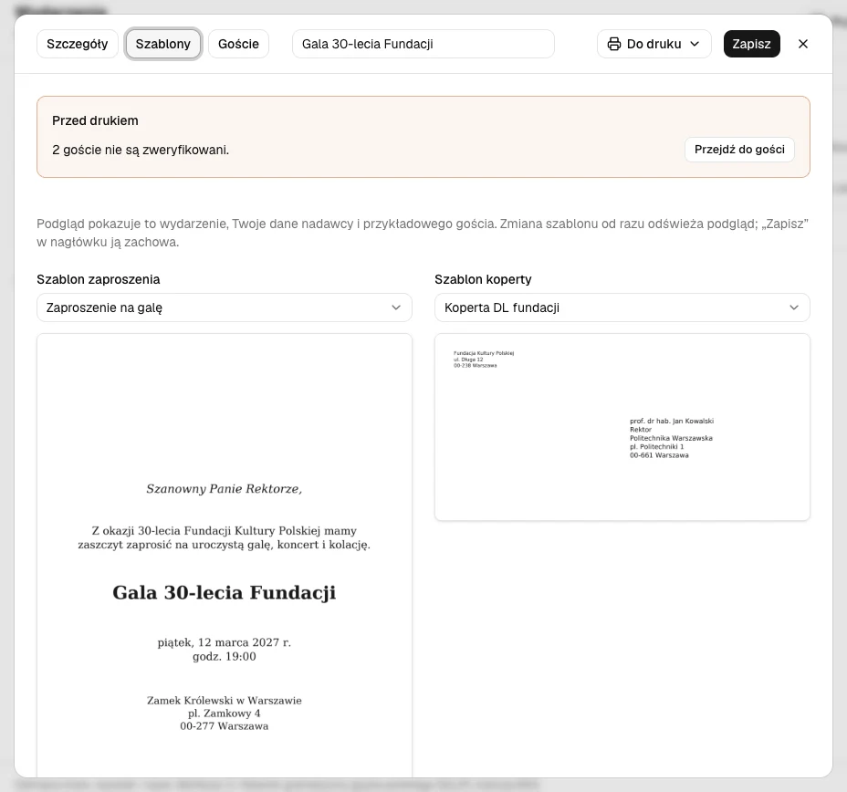

# Zaproszenia

A web app that prepares printed invitations and envelopes for events. You keep a base of guests, lay out the invitation and envelope on a PDF design, and the app fills in each guest's name, salutation and address, declined correctly in Polish, and produces print-ready PDF files.



The app's interface is in Polish and made for desktop browsers. A user guide with screenshots is built into the app at `/instruction` (English) and `/instruction/pl` (Polish).

## What it does

- **Guests**: a guest base with search, paging, bulk actions and an import from CSV or XLSX that previews what will be added, skipped as a duplicate or rejected, before saving.
- **Verification**: an AI check (Gemini) of titles, names, institutions and addresses, with an address lookup in the Google Geocoding API. Suggestions wait for the user's review; nothing is changed without approval.
- **Templates**: upload a PDF design or start from a system template, then place fields on it in an editor with a live preview: guest, event and sender data, the grammatical case of names, the date format, font, size and position.
- **Events**: details, the choice of templates with a preview of this event, the guest list with invitation statuses, and warnings about what is still missing before printing.
- **Printing**: one PDF with the invitations or the envelopes of every guest on the event's list.
- **Data**: soft delete with restore everywhere, and the deletion of all of an account's data (GDPR).

## How it is built

| Part | Stack |
| --- | --- |
| `src/frontend` | Next.js 16 (App Router), React 19, TypeScript, Tailwind CSS 4, shadcn/ui, Conform and Zod; Feature-Sliced Design, checked by Steiger |
| `src/api` | Python 3.14, FastAPI, SQLAlchemy 2 (async) with Alembic, PostgreSQL; pypdf, pypdfium2 and ReportLab for PDFs; Morfeusz 2 for Polish declension |
| Sign-in | Firebase Authentication (Identity Platform) with email and password |
| AI | Gemini on Vertex AI through the google-genai SDK |
| Hosting | Google Cloud Run, one service per component, with Cloud Storage for template files; Terraform in `.config/terraform` |

Each folder under `src/` with a Dockerfile is a Cloud Run service. The frontend calls the API from the server only; the browser never talks to the API directly.

## Running it locally

Requirements: [mise](https://mise.jdx.dev), Docker, and for the AI check `gcloud auth application-default login`.

```sh
mise install --monorepo   # Node, Python, Terraform and the other tools
lefthook install          # the pre-commit checks
mise run dev              # the database, the API and the frontend, with reload on change
```

The app runs at http://localhost:3000 and the API at http://localhost:8000. Locally there is no sign-in: the API signs every request in as `DEV_AUTH_USER` (`dev@localhost`) and adds a few sample guests on start. The address check needs `GEOCODING_API_KEY` in `src/api/.env`; without it the AI check skips the address lookup.

`mise run clean` removes the stack's containers; the data volumes stay.

## Checks

The pre-commit hooks check staged files; GitHub Actions (`Checks`) runs the same over the whole project on every push.

```sh
# src/frontend
npx --no-install eslint --max-warnings=0 . && npx --no-install tsc --noEmit \
  && npx --no-install steiger ./src && npx --no-install prettier --check .

# src/api
uv run --frozen ruff check . && uv run --frozen ruff format --check . \
  && uv run --frozen mypy . && uv run --frozen pytest -q
```

## Deploying

Every merge to `main` deploys: the `Infrastructure` workflow runs the database migrations (they must stay backwards compatible, since old instances keep serving meanwhile) and applies Terraform, which builds the images and updates the Cloud Run services. Work happens on `feat/`, `fix/` and `refactor/` branches merged through pull requests.

## User guide screenshots

The guide's screenshots are taken by a script from a fresh local stack with sample data: `npm run screenshots:instruction` in `src/frontend`. See [its README](src/frontend/scripts/instruction-screenshots/README.md).

## Credits

Declension of names uses [Morfeusz 2](https://morfeusz.sgjp.pl/) and the Grammatical Dictionary of Polish (SGJP), under the BSD license.
